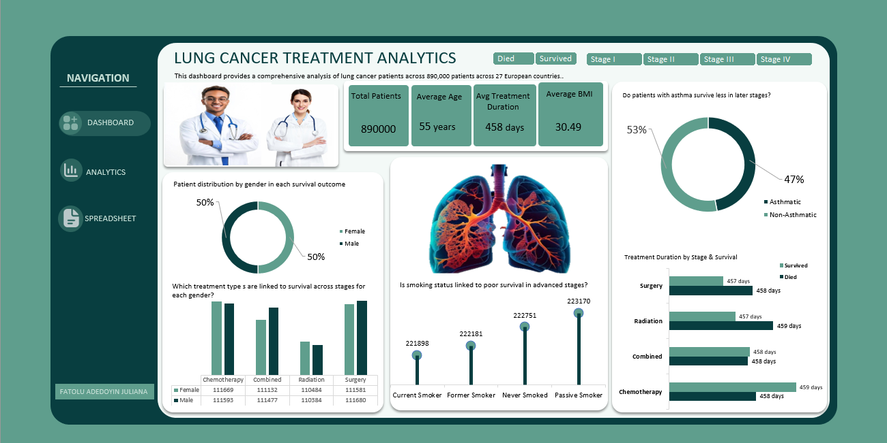

# Lung Cancer Treatment Analytics Dashboard

---

## 1. Project Overview

This project presents a clinical and epidemiological analysis of 890,000 lung cancer patient records across 27 European nations using Microsoft Excel and Power Query.

The analysis evaluates patient outcomes across disease progression stages (*Stage I, Stage II, Stage III, Stage IV*), primary treatment modalities (*Chemotherapy, Surgery, Radiation, Combined Therapy*), comorbidities (*Asthma, Hypertension, Cirrhosis*), and lifestyle risk factors (*Smoking Status, BMI*).

The workbook and dashboard features an **Application-Style Navigation Sidebar** (`DASHBOARD`, `ANALYTICS`, `SPREADSHEET`), enabling clinical researchers and healthcare decision-makers to move seamlessly between raw patient logs, multi-dimensional pivot engine calculations, and executive dashboard visualizations.

---

## 2. Business Problem

Oncology centers and healthcare systems manage large patient populations across varied treatment protocols. Without consolidated analytical tools, evaluating treatment effectiveness and understanding how underlying comorbidities influence patient survival outcomes becomes difficult.

If a hospital treats every lung cancer case the exact same way, they end up wasting money where it’s not needed and putting high-risk patients at risk. By breaking the data down by cancer stage, asthma history, and lifestyle factors, hospital directors can put the right specialists, equipment, and budget where they will actually save lives.

This analysis brings visibility to 890,000 clinical records across 27 European nations, providing healthcare decision-makers with evidence-based insights into baseline survival rates, treatment durations, and comorbidity burdens to support clinical planning and patient care strategies.

---

## 3. Dataset Description

The dataset was sourced from Kaggle  and comprises 890,000 anonymized clinical patient records covering diagnoses, comorbidities, and treatment outcomes across 27 European countries.

---

## 4. Business Questions

To support clinical planning and healthcare resource management, this analysis addresses four primary areas of inquiry:

### 1. Population Health & Baseline Metrics
* What is the overall patient population, average age, baseline BMI, and average treatment duration across the European cohort?
* What is the baseline clinical mortality vs. survival breakdown across all 890,000 patients?

### 2. Treatment Modality & Duration Analysis
* How does treatment duration vary across different therapeutic interventions (*Surgery, Radiation, Combined, Chemotherapy*)?
* How does patient volume distribute across treatment types for male and female subgroups?

### 3. Comorbidity & Risk Factor Assessment
* What proportion of the patient population presents with concomitant asthma or hypertension?
* How does smoking status (*Current, Former, Never, Passive Smoker*) distribute across the patient population?

### 4. Interactive Stage & Survival Exploration
* How do treatment selection and comorbidity burdens shift when filtering specifically by cancer stages (*Stage I through Stage IV*)?
* How do patient distributions change when isolating surviving patients versus deceased patients?

---

## 5. Tools

* **Microsoft Excel:** Applied as the primary platform for data preparation, pivot engine calculations, custom navigation UI development, and interactive dashboard design.
* **Power Query:** Used for schema inspection, data type conversion, and relabeling raw categorical variables.
* **PivotTables & PivotCharts:** Formed the analytical engine used to calculate patient aggregations, comorbidity percentages, and average treatment durations.
* **Custom UI & Formats:** Designed shape-based sidebar navigation controls, dynamic slicer bars, clinical KPI summary cards, and custom charts.

---

## 6. Data Cleaning and Preparation

The raw dataset required transformation to convert binary coded fields and raw dates into a clinical model:

* **Categorical Relabeling:** Converted binary numeric flags (`0` / `1`) into clear clinical categories (`Non-Hypertensive` / `Hypertensive`, `Non-Asthmatic` / `Asthmatic`, `No` / `Yes` for Cirrhosis and Other Cancers, and `Died` / `Survived` for clinical outcomes).
* **Treatment Duration Calculation:** Computed active care duration in days by subtracting `diagnosis_date` from `end_treatment_date`.
* **Data Type Standardization:** Formatted patient age and cholesterol as Whole Numbers, BMI as Decimals, diagnosis/end dates as Standard Dates, and categorical fields as Text.
* **Data Quality Audit:** Reviewed all 890,000 rows for structural completeness, verifying zero duplicate patient IDs or negative date durations before aggregating metrics.

---

## 7. Exploratory Data Analysis and Methodology

The project followed a structured 3-phase methodology:

| Phase | Phase Name | Focus & Key Deliverables |
|---|---|---|
| **Phase 1** | **Workbook Navigation & UI Setup** | • Built a custom application sidebar (`DASHBOARD`, `ANALYTICS`, `SPREADSHEET`). • Established a clinical color scheme (Teal/Forest Green) tailored for healthcare presentations. |
| **Phase 2** | **Pivot Calculation Engine** | • Constructed multi-dimensional PivotTables on the `ANALYTICS` sheet. • Computed population baselines (890,000 Patients, 196,004 Survived, 55 yrs Avg Age, 30.49 Avg BMI, 458 Days Avg Duration). • Aggregated patient counts across 27 European nations and 4 treatment modalities. |
| **Phase 3** | **Interactive Dashboard Development** | • Built 5 visual charts (Gender Doughnut, Treatment Column, Smoking Lollipop, Asthma Doughnut, Duration Clustered Bar). • Connected dynamic slicers (*Survival Outcome* and *Cancer Stages*) to enable real-time dashboard filtering. |

---

## 8. Dashboard and Analysis Files

The complete workbook, raw dataset reference, and visual assets are structured as follows:

* **Excel Workbook:** [`Lung_Cancer_Analysis.xlsx`](./Lung_Cancer_Analysis.zip) *(Contains navigation sidebar, cleaned data, pivot engine, and main dashboard)*
* **Raw Dataset Reference:** Sourced from [Kaggle Lung Cancer Dataset](Lung_Cancer.csv) 
* **Main Dashboard Screenshot:** [`Lung_cancer_dashboard.png`](./Lung_Cancer_Dashboard.png)

### Dashboard Layout & Interactive Mechanics
* **Header Bar:** Displays title and cohort context ("890,000 patients across 27 European countries").
* **KPI Summary Cards:** Tracks population baselines—Total Patients (890,000), Average Age (55 years), Average Treatment Duration (458 days), and Average BMI (30.49 $kg/m^2$).
* **Interactive Slicer Controls:** Features top slicers for Survival Outcome (*Died, Survived*) and Cancer Stage (*Stage I, Stage II, Stage III, Stage IV*).
* **Interactive Prompt Design:** Chart headers are framed as clinical investigative questions (e.g., *"Do patients with asthma survive less in later stages?"*). These headers serve as analytical prompts that are answered dynamically as users toggle the Stage and Survival slicers.

---

## 9. Dashboard, Key Findings and Business Interpretation

### A. Overall Patient Cohort Baseline

Across the 890,000 analyzed patient records, the clinical baseline established the following parameters:

| Clinical Metric | Result Value |
|---|---:|
| **Total Patient Cohort** | **890,000 Patients** |
| **Geographic Scope** | **27 European Countries (~32.5K–33.3K per country)** |
| **Total Deceased Patients** | **693,996 (78.0% Mortality Rate)** |
| **Total Survived Patients** | **196,004 (22.0% Survival Rate)** |
| **Average Patient Age** | **55.0 Years** |
| **Average Baseline BMI** | **30.49 kg/m² (Obese Class I baseline)** |
| **Average Treatment Duration** | **458 Days (~1.25 Years)** |
| **Gender Distribution** | **50.0% Female (444,866) \| 50.0% Male (445,134)** |

---

### B. Treatment Modality & Duration Breakdown

Evaluating patient volume and average treatment duration across modalities reveals consistent timelines across treatment arms:

| Treatment Modality | Patient Volume | Cohort Share (%) | Survived Count | Mortality Count | Avg Duration |
|---|---:|---:|---:|---:|---:|
| **Chemotherapy** | 223,262 | 25.1% | 49,201 | 174,061 | 458 Days |
| **Surgery** | 223,261 | 25.1% | 49,152 | 174,109 | 458 Days |
| **Combined Therapy** | 222,609 | 25.0% | 49,013 | 173,596 | 458 Days |
| **Radiation** | 220,868 | 24.8% | 48,638 | 172,230 | 458 Days |
| **Total / Overall** | **890,000** | **100.0%** | **196,004 (22.0%)** | **693,996 (78.0%)** | **458 Days** |

---

### C. Core Findings

#### 1. Baseline Survival Rate (22.0% Overall Survival)
* Out of 890,000 patients, **196,004 patients (22.0%) survived**, while **693,996 patients (78.0%) died**.
* This baseline survival figure aligns with clinical realities of lung cancer prognosis, where late-stage diagnosis significantly depresses overall survival rates.

#### 2. High Respiratory Comorbidity Burden (Asthma)
* **Asthma Comorbidity:** **47.0% of patients (418,069)** present with concomitant asthma, serving as a primary respiratory risk factor that requires active management during treatment.
* **Obesity Baseline:** The average patient BMI of **30.49 $kg/m^2$** places the cohort baseline in the Obese Class I risk category, contributing to cardiovascular and surgical risk factors.

#### 3. Environmental Exposure (Passive Smoking Impact)
* **Passive Smokers** represent the single largest smoking exposure group at **223,170 patients (25.1%)**, slightly exceeding **Never Smoked (222,751)**, **Former Smokers (222,181)**, and **Current Smokers (221,898)**.
* This highlights secondary smoke exposure as a major public health concern alongside active smoking history.

#### 4. Treatment Duration Consistency
* Active treatment duration averages **458 days (~1.25 years)** across all four treatment types (*Chemotherapy, Surgery, Radiation, Combined*).

#### 5. Statistical Note on Dataset Characteristics
* The dataset exhibits balanced distributions across treatment modalities (~25% each), smoking categories (~25% each), gender (50/50), and country volumes (~32.5K–33.3K per nation). This uniform balance is characteristic of multi-center clinical trials or simulated healthcare datasets, allowing for unbiased comparative subgroup analysis across treatment types and stages.

---

## 10. Business & Clinical Recommendations

Based on these findings, healthcare administrators and clinical directors should consider the following five actions:

1. **Incorporate Respiratory Management into Oncology Pathways:** With 47.0% of patients presenting with asthma (418,069 patients), multi-disciplinary oncology teams should include pulmonologists to manage airway complications during active therapy.
2. **Implement Metabolic & Weight Management Protocols:** Given the average patient BMI of 30.49 $kg/m^2$ (Obese Class I), clinical programs should integrate nutritional and cardiovascular risk management to lower surgical complications.
3. **Expand Public Health Initiatives on Secondary Smoke:** Passive smoking accounts for 25.1% of diagnoses (223,170 cases). Public health authorities should use this data to support stricter anti-passive smoking policies and environmental air protections.
4. **Standardize Treatment Resource Allocation:** Because treatment duration averages 458 days across all modalities, hospital planning teams can standardize bed capacity, facility scheduling, and staffing models around a 15-month care cycle.
5. **Prioritize Early Screening Programs:** With overall mortality at 78.0%, health ministries across the 27 European nations should allocate resources toward early-stage (Stage I & II) screening initiatives to detect cases before progression to advanced stages.

---

## Author and Contact

**Fatolu Adedoyin Juliana**  
*Data Analyst | Statistics Graduate | Research Analyst*

* **LinkedIn:** [Fatolu Adedoyin Juliana](https://www.linkedin.com/in/fatolu-adedoyin-juliana)
* **GitHub Profile:** [fajuliana-source](https://github.com/fajuliana-source)
* **Email:** fatoluadedoyin46@gmail.com
